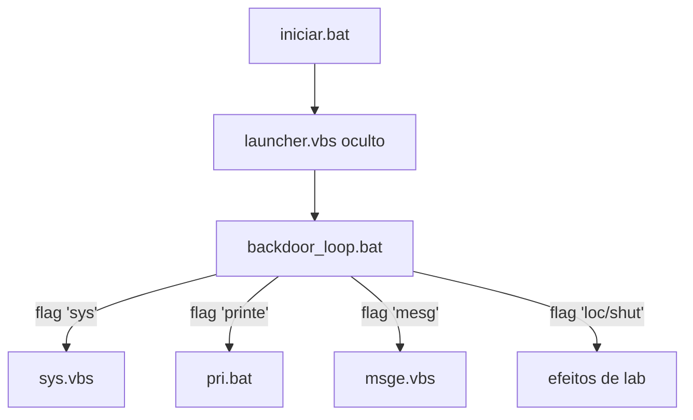

# 🧪 Batch-Backdoor-Agent — Backdoor de Laboratório (Batch/VBS)
<p align="center">
  
  <a href="https://github.com/panda12332145/Batch-Backdoor-Agent/commits/main"></a>
  <a href="https://github.com/panda12332145/Batch-Backdoor-Agent"></a>
  
</p>
---
> 🚨 **DISCLAIMER OBRIGATÓRIO — LABORATÓRIO ONLY:** este projeto é um exercício didático de **análise de malware e defesa**. Execute **exclusivamente** em máquinas virtuais isoladas, com consentimento de todos e sem rede real. Utilizá-lo contra sistemas sem autorização configura crime (art. 154-A e afins). Nenhum dado de terceiros acompanha este repositório.

---
## 🔖 Resumo

Agente **backdoor em Batch/VBS** para estudo de engenharia reversa: um **loop de triggers** observa arquivos-sinal (`sys`, `printe`, `mesg`...) e dispara scripts auxiliares (screenshot via nircmd, msgbox, coleta de info do host). Inclui launcher oculto (`.vbs`), entrada `iniciar.bat` e coletor `info_stealer.bat`. **Dado real de vítima removido**; referências quebradas corrigidas; legados com FTP/endpoints pessoais removidos.

### ✨ Funcionalidades Principais

- ✅ Loop de triggers por *arquivo-flag* (padrão clássico de malware)
- ✅ Scripts auxiliares desacoplados em `scripts/` com paths `%~dp0` (robustos ao cwd)
- ✅ Launcher oculto `launcher.vbs` + entrada única `iniciar.bat`
- ✅ Coletor `info_stealer.bat` grava em `data/` (gitignorado — nada vaza p/ o repo)
- ✅ Legados removidos: FTP hardcoded, caminho pessoal e duplicatas quebradas
- ✅ Testes de **integridade de estrutura**: toda referência do loop aponta p/ arquivo existente

## 📽 Demonstração

```text
# VM de laboratório isolada:
iniciar.bat
# crie um arquivo 'sys'  → dispara scripts/sys.vbs
# crie um arquivo 'mesg' → exibe msgbox de lab
# apague os arquivos-flag para parar
```

## ⚙️ Explicação das Partes Importantes

### Loop de triggers corrigido (`src/backdoor_loop.bat`)

```bat
if exist "sys" (start "" "%~dp0..\scripts\sys.vbs")
if exist "printe" (start "" "%~dp0..\scripts\pri.bat")
if exist "mesg" (start "" "%~dp0..\scripts\msge.vbs")
```

> `%~dp0` ancora os paths no diretório do SCRIPT — antes, `..\scripts\pri.vbs` (arquivo inexistente!) e cwd errado quebravam tudo.

### Porta de entrada única

```bat
rem iniciar.bat
start "" "%~dp0scripts\launcher.vbs"
```

> Um único ponto de entrada facilita subir em VM e também remediá-la.

## 🔄 Fluxo de Trabalho / Arquitetura



## 📂 Estrutura do Projeto

```plaintext
Batch-Backdoor-Agent/
├── iniciar.bat           # entrada única
├── src/
│   ├── backdoor_loop.bat # loop de triggers (refs corrigidas)
│   └── info_stealer.bat  # coletor didático (data/ gitignorado)
├── scripts/              # payloads .bat/.vbs acionados
├── data/.gitkeep         # saídas locais NÃO commitam (*.txt)
├── tests/test_structure.py  # 6 testes de integridade
├── requirements.txt
└── README.md
```

## 🛠️ Tecnologias

| Ferramenta | Uso |
|---|---|
| **Batch/cmd** | Scripts nativos Windows |
| **VBScript** | Launchers ocultos |
| **Estrutura por triggers** | Padrão didático de C2 |

## ▶️ Instalação

```bash
git clone https://github.com/panda12332145/Batch-Backdoor-Agent.git
cd Batch-Backdoor-Agent
# sem dependências — scripts nativos Windows
```

## 🚀 Execução

```bash
# APENAS em VM isolada e autorizada:
iniciar.bat

# flags de exemplo (crie na raiz da VM):
   fsutil file createnew sys 0
   fsutil file createnew mesg 0
# apague as flags para parar

# Testes de estrutura (qualquer SO):
python tests/test_structure.py
```

## 🧪 Testes

6 testes de integridade: vítima `ifos.txt` ausente, toda referência do loop existe no repo, sem `pri.vbs`/`key.vbs`/`FTP-CONFIG`/caminho pessoal, legados removidos, entrada e launcher presentes.

## ⚠️ Limitações

- Windows apenas (os testes de estrutura rodam em qualquer SO)
- Depende de `nircmd.exe` para screenshot (terceiro, não incluído)
- Sem persistência/registro — propósito é analisar triggers e coleta

## 🚀 Roadmap

- [ ] Variante com Sysinternals autorizados (Autoruns/Sysmon p/ defesa)
- [ ] YARA rules de detecção para o padrão de triggers
- [ ] Página de IOCs no README

## 📄 Licença

Todos os direitos reservados ao autor.

---

## 👾 Autor

<p align="center">
  
</p>

<p align="center">Feito por <strong>Panda12332145</strong> 👋🏽</p>

---

## 🧑‍💻 Sobre Mim

Sou apaixonado por **Física Teórica, Cibersegurança e Desenvolvimento de Sistemas**. Tenho grande interesse em programação de baixo nível, engenharia reversa, automação, sistemas Windows, criptografia e segurança ofensiva. Também gosto bastante de música, filosofia e computação avançada.

---

## 🌐 Redes

* **Site:** [https://panda-h0me.netlify.app/](https://panda-h0me.netlify.app/)
* **YouTube:** [https://www.youtube.com/@X86BinaryGhost](https://www.youtube.com/@X86BinaryGhost)
* **Instagram:** [https://www.instagram.com/01pandal10/](https://www.instagram.com/01pandal10/)
* **GitHub:** [https://github.com/panda12332145](https://github.com/panda12332145)
* **LinkedIn:** [linkedin.com/in/athos-da-boanergis](https://www.linkedin.com/in/athos-d%C3%A3-boanergis-5585a4288/)

---

## 🚀 Áreas de Interesse

* **Cibersegurança Avançada** 🔒
* **Hacking & Engenharia Reversa** 💻
* **Computação de Baixo Nível** 🖥️
* **Matemática e Física Teórica** 📐⚛️
* **Desenvolvimento de Ferramentas de Segurança** 🛠️

_"Conhecimento é poder, e domínio técnico vem da compreensão profunda dos sistemas."_

---

## 📞 Contato & Suporte

Para colaborações, dúvidas ou sugestões:

📧 **E-mail:** [athos.cybersec@gmail.com](mailto:athos.cybersec@gmail.com)

🐛 **Reportar Bug:** [Abrir Issue](https://github.com/panda12332145/Batch-Backdoor-Agent/issues)

💡 **Sugerir Melhoria:** [Discussions](https://github.com/panda12332145/Batch-Backdoor-Agent/discussions)
